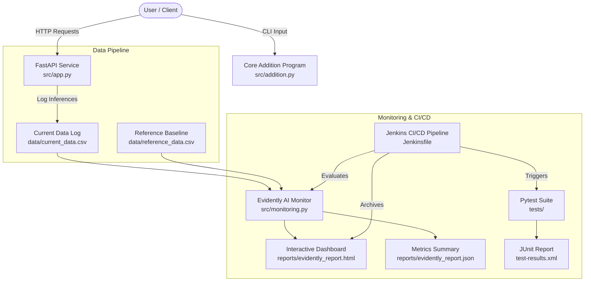

# Addition MLOps Service: Python, FastAPI, Pytest, Evidently & Jenkins

A production-ready MLOps project demonstrating the integration of a Python arithmetic program across a complete DevOps/MLOps toolchain:
- **Core Python**: Interactive & argument-driven addition program.
- **FastAPI**: Asynchronous REST API with Pydantic validation, OpenAPI documentation, and request logging.
- **Pytest**: Comprehensive unit and integration test suite with coverage and JUnit XML reporting.
- **Evidently AI**: Data drift, data quality, and automated test suite evaluation with interactive HTML dashboards.
- **Jenkins**: Declarative CI/CD pipeline automating linting, testing, Evidently drift gating, and artifact publishing.
- **Git**: Version-controlled repository with clean commit history, `.gitignore`, and branching strategy.

---

## Architecture Overview



---

## Directory Structure

```
.
├── .gitignore               # Ignored files, virtual environments, caches, reports
├── Dockerfile               # Multi-stage production container build
├── Jenkinsfile              # Declarative CI/CD pipeline script
├── README.md                # Project documentation and user guide
├── pytest.ini               # Pytest configuration settings
├── requirements.txt         # Project dependencies
├── data/
│   ├── current_data.csv     # Current batch of requests/predictions
│   └── reference_data.csv   # Baseline reference dataset for drift detection
├── reports/
│   ├── .gitkeep             # Directory placeholder for CI/CD artifacts
│   ├── evidently_report.html# Evidently HTML visual dashboard (generated)
│   └── evidently_report.json# Evidently metrics JSON (generated)
├── src/
│   ├── __init__.py          # Python package initializer
│   ├── addition.py          # Core addition logic and standalone CLI interface
│   ├── app.py               # FastAPI application with REST endpoints
│   └── monitoring.py        # Evidently AI data drift and quality monitoring
└── tests/
    ├── __init__.py          # Test package initializer
    ├── test_addition.py     # Pytest unit tests for addition logic and CLI
    ├── test_api.py          # Pytest integration tests for FastAPI endpoints
    └── test_monitoring.py   # Pytest tests for Evidently monitoring and data checks
```

---

## 1. Quick Start & Installation

### Step 1: Clone or Open the Repository
```bash
git clone <your-repository-url>
cd "MLDevOps External POE"
```

### Step 2: Set Up Python Virtual Environment
```bash
# Create virtual environment
python3 -m venv .venv

# Activate virtual environment
# On Linux / macOS:
source .venv/bin/activate
# On Windows:
# .venv\Scripts\activate

# Upgrade packaging tools
pip install --upgrade pip setuptools wheel

# Install dependencies
pip install -r requirements.txt
```

---

## 2. Core Python Program (`src/addition.py`)

The core program accepts two numbers and displays their addition. It supports both interactive prompts and command-line flags.

### Interactive Mode:
```bash
python3 src/addition.py
```
**Example Session:**
```
=============================================
       Python Addition Calculator
=============================================
Enter the first number: 18.5
Enter the second number: 21.5
---------------------------------------------
First Number  : 18.5
Second Number : 21.5
Addition (+)  : 40
---------------------------------------------
Formula: 18.5 + 21.5 = 40
=============================================
```

### Command-Line Arguments Mode:
```bash
python3 src/addition.py --num1 100 --num2 250
```

---

## 3. FastAPI Service (`src/app.py`)

The addition program is exposed via a high-performance asynchronous REST API.

### Starting the FastAPI Server:
```bash
uvicorn src.app:app --host 0.0.0.0 --port 8000 --reload
```

### Interactive Documentation:
Once running, navigate to:
- **Swagger UI**: [http://localhost:8000/docs](http://localhost:8000/docs)
- **ReDoc**: [http://localhost:8000/redoc](http://localhost:8000/redoc)

### Endpoints Overview:

| Method | Endpoint | Description |
|---|---|---|
| `GET` | `/health` | Health check endpoint returning uptime and service status. |
| `POST` | `/api/v1/add` | Accepts JSON body `{"num1": 10.5, "num2": 4.5}` and returns result. |
| `GET` | `/api/v1/add` | Accepts query parameters `?num1=10&num2=20` and returns result. |
| `POST` | `/api/v1/add/batch`| Accepts a list of pairs and processes them in batch. |

### Sample cURL Requests:

```bash
# 1. Health check
curl -X GET "http://localhost:8000/health"

# 2. POST Addition
curl -X POST "http://localhost:8000/api/v1/add" \
     -H "Content-Type: application/json" \
     -d '{"num1": 42.5, "num2": 57.5}'

# 3. GET Addition
curl -X GET "http://localhost:8000/api/v1/add?num1=15&num2=25"

# 4. Batch Addition
curl -X POST "http://localhost:8000/api/v1/add/batch" \
     -H "Content-Type: application/json" \
     -d '{
       "items": [
         {"num1": 10, "num2": 20},
         {"num1": 5.5, "num2": 4.5}
       ]
     }'
```

---

## 4. Pytest Test Suite (`tests/`)

The project contains unit and integration tests covering arithmetic logic, edge cases, FastAPI endpoints, and monitoring modules.

### Running Pytest:
```bash
# Run all tests with verbose output
pytest

# Run tests and generate JUnit XML report (used by Jenkins)
pytest --junitxml=reports/test-results.xml

# Run tests with code coverage report
pytest --cov=src --cov-report=term-missing --cov-report=html:reports/coverage
```

### Test Structure:
- `tests/test_addition.py`: Validates positive/negative floats, integers, zero identity, large numbers, invalid type exceptions, and CLI interfaces.
- `tests/test_api.py`: Validates FastAPI status codes (200, 422), response structures, and batch calculations.
- `tests/test_monitoring.py`: Validates synthetic data generation, CSV storage, and Evidently test suite runs.

---

## 5. Evidently AI Monitoring (`src/monitoring.py`)

Evidently AI monitors data quality and data drift for the addition service:
1. **Data Quality Preset**: Verifies column data types, missing value rates, and statistical distributions.
2. **Data Drift Preset**: Compares incoming distributions of `num1`, `num2`, and `result` against the reference baseline using statistical tests (Kolmogorov-Smirnov / Wasserstein distance).
3. **Automated Test Suite**: Gates the Jenkins CI/CD pipeline by failing if missing values or significant drift are detected.

### Running Evidently Monitoring:
```bash
python3 src/monitoring.py \
    --reference data/reference_data.csv \
    --current data/current_data.csv \
    --output-html reports/evidently_report.html \
    --output-json reports/evidently_report.json
```

### Viewing the Dashboard:
Open `reports/evidently_report.html` in any web browser to view the interactive visualizations.

---

## 6. Jenkins CI/CD Pipeline (`Jenkinsfile`)

The repository includes a declarative `Jenkinsfile` for automated CI/CD.

### Pipeline Stages:
1. **Checkout Code**: Retrieves the latest revision from the Git repository.
2. **Environment Setup**: Creates virtual environment and installs dependencies from `requirements.txt`.
3. **Code Linting**: Analyzes source files using `flake8`.
4. **Run Pytest Suite**: Executes all test suites and generates JUnit XML test results.
5. **Evidently Monitoring & Drift Gating**: Evaluates data drift and quality suites; gates deployment if thresholds fail.
6. **FastAPI Health Smoke Test**: Validates API integrity before deployment.
7. **Post Actions**:
   - Publishes JUnit XML test results.
   - Archives report artifacts.
   - Publishes the interactive Evidently HTML dashboard via the Jenkins HTML Publisher plugin.

### Configuring Jenkins:
1. Install required Jenkins plugins:
   - **Git Plugin**
   - **JUnit Plugin**
   - **HTML Publisher Plugin**
   - **Pipeline Plugin**
2. In Jenkins, create a **New Item** -> **Pipeline**.
3. Under **Pipeline Definition**, select **Pipeline script from SCM**.
4. Choose **Git**, specify your repository URL, set branch to `*/main`, and script path to `Jenkinsfile`.
5. Click **Save** and select **Build Now**.

---

## 7. Docker Deployment

### Build Docker Image:
```bash
docker build -t addition-mlops-service:latest .
```

### Run Container:
```bash
docker run -d -p 8000:8000 --name addition-service addition-mlops-service:latest
```

Verify service:
```bash
curl http://localhost:8000/health
```

---

## 8. Git Version Control

Git is mandatory and initialized on the `main` branch.

### Git Status & Verification:
```bash
git status
git log --oneline
```

### Pushing to a Remote Git Repository (e.g. GitHub / GitLab):
```bash
git remote add origin <REMOTE_REPOSITORY_URL>
git branch -M main
git push -u origin main
```
